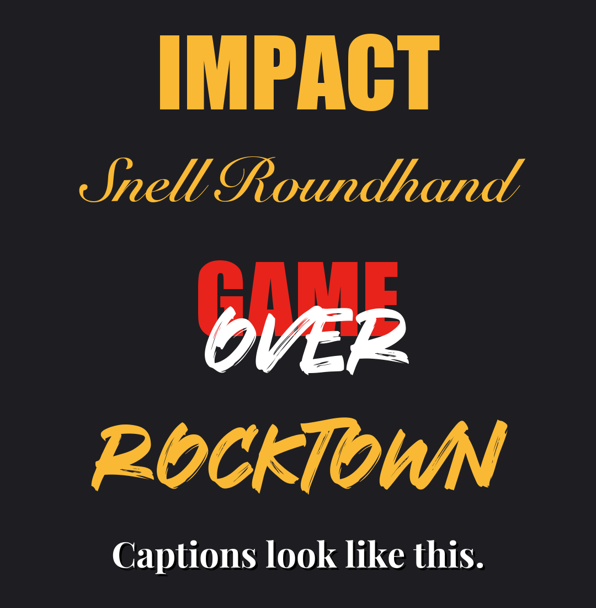

# Claude Code skill for Instagram Reels hooks, TikTok and YouTube Shorts scripts

**viral-reel-playbook** is a free, open-source [Claude Code](https://claude.com/claude-code) skill that writes short educational video scripts for Instagram Reels, TikTok and YouTube Shorts: the hook, the rehook around 15 to 20 seconds, the funnel job of each video and the caption look. The goal is videos people watch to the end and that bring in clients, not just views.

It is built from the transcripts of six reels by six creators. Each rule links back to the reel it came from:

| Part | What it answers | Learned from |
|---|---|---|
| Step 0: be known for one thing | What should my channel be about, and how does it make money? | Sam Stoffel ([reel](https://www.instagram.com/reel/DeERlGvM9LK/)) |
| The three questions | Nobody's watching. Should I post more? (No: who's watching, why should they care, what will they remember?) | Elliott Vitzthum ([reel](https://www.instagram.com/reel/DfZnojzItNF/)) |
| Step 1: the funnel job | Is this video for reach, for follows or for clients? | Dan Martell ([reel](https://www.instagram.com/reel/DcL47JZiiu0/)) |
| Step 2: five watch-longer patterns | How do I open, and how do I stop people leaving at 15 seconds? | Chris Chung ([reel](https://www.instagram.com/reel/Dd6jg8FvvAS/)) |
| Step 3: make the frame work | Shock word, countdown timer, a setting that proves it, a follow ask that names a result; a cutaway every few seconds that shows the line being said | Sam Stoffel, Elliott Vitzthum |
| The truth format | I'm scared to post, or I froze on camera. Now what? | Benji Wilkins ([reel](https://www.instagram.com/reel/Ddkc7wwofQ1/)) |
| The look | Which fonts, colors and caption placement? | Kalyl ([reel](https://www.instagram.com/reel/DcBwAjvoEqI/)) |

One rule runs through all of it: **never invent a result to fit a pattern.** Every number, story and backdrop has to be real.



## Install

Clone it into your personal skills folder, and it works in every project:

```bash
git clone https://github.com/s77sh/viral-reel-playbook ~/.claude/skills/viral-reel-playbook
```

Or put it in one project only, at `.claude/skills/viral-reel-playbook/`.

## Use

Open Claude Code and ask in plain words. For example:

- "viral-reel-playbook: write a 40-second script about [topic]"
- "Rehook this script, people drop off at 15 seconds"
- "Is this a top, middle or bottom of funnel video?"
- "Nobody watches my videos. Should I post more?"
- "What should I be known for?"
- "I froze on camera today, can I still post it?"
- "Which fonts should my captions use?"

Claude names the funnel stage, picks an opening pattern, adds a rehook around 15-20 seconds, and checks every claim before handing it back.

## Make it yours

Add a `personal.md` next to `SKILL.md` with your own rules: topics you won't touch on camera, your real results and examples, your voice notes, and font paths. The skill reads it first, and it overrides the general rules. It's in `.gitignore`, so it never gets pushed.

## Credits

The ideas belong to the creators linked above; this repo only summarizes and organizes them. Go follow them. The spotlight-effect research is Gilovich, Medvec and Savitsky (2000), *Journal of Personality and Social Psychology*.

**Fonts:**
- Impact and Snell Roundhand ship with the OS.
- Playfair Display is free (SIL Open Font License).
- Rocktown is free for personal use only; buy a commercial license before using it in posted videos.

No font files are included.

## FAQ

**What is a Claude Code skill?**
A folder with a `SKILL.md` file that Claude Code loads when your request matches it. Once it's in `~/.claude/skills/`, you don't call it by hand: ask for a reel script and Claude uses it.

**Does it work for TikTok and YouTube Shorts, or only Instagram Reels?**
All three. The hooks, rehooks and funnel stages work the same way on any short vertical video.

**Can it write reel hooks on their own?**
Yes. Ask for hook ideas for a topic and it gives openings built on the five watch-longer patterns, with a rehook for the 15 to 20 second mark.

**Will it make up results to make a hook work?**
It shouldn't. The skill's core rule is never to invent a result to fit a pattern: every number, story and backdrop has to be real. If you don't have the result a pattern needs, use a different pattern.

**Does it work with other AI agents?**
It's written for Claude Code. The `SKILL.md` is plain Markdown, so you can paste it into any agent that takes instructions.

## Related repos

- [claude-seo-skills-benchmark](https://github.com/s77sh/claude-seo-skills-benchmark): 5 Claude Code SEO skill packs tested on 20 planted problems.
- [claude-random-numbers](https://github.com/s77sh/claude-random-numbers): which number Claude picks when asked for a random one, 446 prompts.
- [interview-prep-pack](https://github.com/s77sh/interview-prep-pack): a Claude Code skill that builds interview prep from your own resume.
- [bali-product-demand](https://github.com/s77sh/bali-product-demand): Google Keyword Planner demand for 36 product niches in Bali.

All of them, with what each one is for: [saeedseo.com/repos/](https://saeedseo.com/repos/).

## Author

Saeed Shahriar, senior SEO and growth marketer. [saeedseo.com](https://saeedseo.com)

## License

MIT
