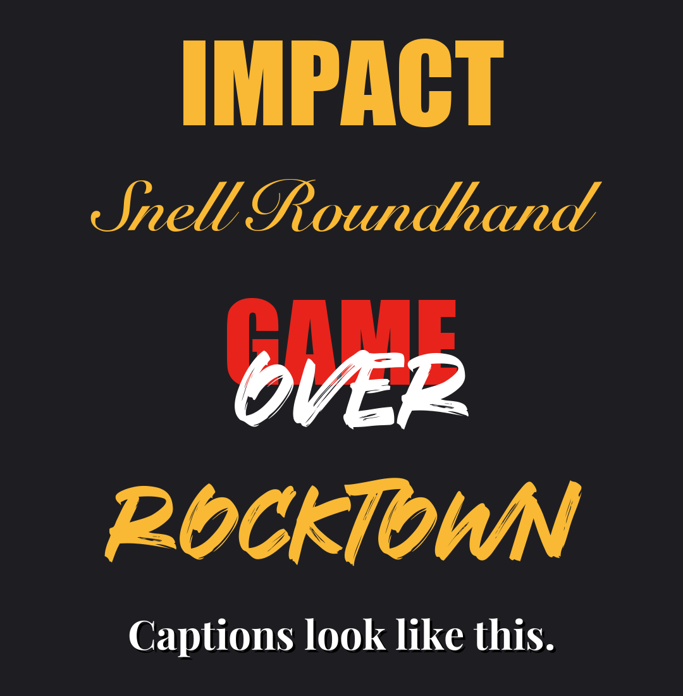

# viral-reel-playbook

The playbook answers four things: what you're known for, whether a video is worth making, what it's for, and how to hold the viewer to the end.

**First:** if `personal.md` exists next to this file, read it. It holds the creator's own rules, examples, file paths and voice, and it overrides anything general here.

## Step 0: be known for one thing

From Sam Stoffel (@samstoffel), "how to actually get rich with Instagram in 60 seconds", https://www.instagram.com/reel/DeERlGvM9LK/ (67 s, about 107K likes, 729 comments).

- **Followers aren't money; customers are.** A brand is what people think of when they hear your name, and whether they'd notice if you disappeared.
- **One problem you have actually solved.** Become the person people think of when that problem comes up. Not a topic ("AI", "fitness"), but a problem with a before and an after.
- **Show your face, your mistakes and your results.** Tell the story of what changed it for you.
- **Keep saying the same thing.** Repetition is how people learn what you're for. A new angle each day, the same problem every day.
- **Sell a way to get the same result:** a product you own (a course, a community, mentorship, a done-for-you service). "If you don't sell something, you can't make money."
- **Test for any niche:** can you say it in one sentence a stranger understands? "I help [who] [get what result], because I [did it myself]." If the last part isn't true yet, it isn't your niche yet.

## Before every video: the three questions

From Elliott Vitzthum (@ellvitz), https://www.instagram.com/reel/DfZnojzItNF/ (67 s). He runs a content agency, and his point is that posting more won't fix videos nobody cares about. Answer all three before recording. If you can't, change the idea, not the posting schedule.

1. **Who is actually watching this?** One kind of person, named.
2. **Why should they care?** What does it change for them, not for you?
3. **What are they left with to remember you?** One line, number or picture they could repeat to a friend.

A video about you ("my story", "my journey") fails question 2 unless the story hands the viewer something: a lesson, a tool, or a question they want to answer.

## Step 1: pick the funnel job before you hit record

From Dan Martell (@danmartell), https://www.instagram.com/reel/DcL47JZiiu0/ (44 s). His point: if you don't know the purpose of a video before you record, it's just noise.

| Stage | Job | What it is | Best opening patterns |
|---|---|---|---|
| **TOFU** | Reach: new eyeballs | Something anyone will watch, even if they've never heard of you | P3 belief then flip, P1 result first |
| **MOFU** | Viewers into followers | Education and your story: who you are, why follow | P2 not A or B, P4 rehook, a story question |
| **BOFU** | Followers into clients | Speak to the pain of the person who'd pay you, then one offer | P5 unless, P1 with the client's result |

- **Every brief names its stage** (`[TOFU]`, `[MOFU]`, `[BOFU]`) before anything else.
- **The mix needs all three.** Attention, then a follow, then a client. A batch with no BOFU gets views and no work; a batch of only BOFU gets no one to sell to. Aim for at least one BOFU a week, more once followers grow.
- **A BOFU video opens on the buyer's pain** in their own words, not on your achievement. It ends on one concrete ask (a comment keyword or a DM), never several.
- The pain must be real for the buyer, and any proof must be real for you.

## Step 2: the five patterns that hold viewers

From Chris Chung (@iamchrischung), https://www.instagram.com/reel/Dd6jg8FvvAS/ (25 s). Every pattern makes the viewer stay for something they haven't heard yet.

| # | Pattern | Line shape | Why they stay |
|---|---|---|---|
| P1 | **Result first** | "This did [result]. Here's exactly how." Then the steps. | They learn with every step toward a result they already believe. |
| P2 | **Not A or B** | "It's not A, and it's not B. It's C." | They stay for C. |
| P3 | **Belief, then flip** | "Everyone says [common belief]." Then "[what's actually true]." | They stay to hear why. |
| P4 | **Rehook** | "But here's the better way" or "...the best way," around 15-20 s. | It resets attention mid-video. |
| P5 | **Unless** | "This won't work unless you [X]." | They stay to hear how. |

### How to use them

1. **Name the funnel stage**, then **pick one opening pattern** (P1, P2, P3 or P5) for the first 1-2 seconds. Say the topic word in the same breath.
2. **Add P4 to every video over 20 seconds**, around the 15-20 second mark, just before the energy would drop.
3. **End by paying off the open loop** (the C, the why, the how), then one call to action.
4. **Vary patterns across a batch.** Three P3s in a row reads like a formula. Tag each brief, for example `[P1 result first]`, so the mix is visible.
5. **Only when it's true.** A result must be real, a flip must be what the creator actually found, and an "unless" must be the real condition. If the true story doesn't fit a pattern, use a plain hook. Never invent a result to fit a shape.

### Example shapes

- **P1:** "This one post got [real number] views. Here's exactly how I made it."
- **P2:** "It's not one resume for every job, or a new one for every application. It's four versions."
- **P3:** "Everyone blames the model when AI writing sounds generic. It's not the model. It just doesn't know how you talk."
- **P4:** "...But here's the better way: it drafts, and it waits for my yes."
- **P5:** "This tool won't save you time unless you give it one file to read first."

## Step 3: tricks that make the frame do work

From Sam Stoffel's reel, which is one locked-off shot with no cuts and still holds:

- **A shock word in the first second.** A single huge word fills the top of the frame for under a second, before the real title. It stops the thumb. (He uses a swear word in red. Pick one that fits the creator's lines.)
- **Promise a length, then show a timer.** "...in 60 seconds" in the title plus a countdown in the corner. People stay to see it finish. Only promise a length the video keeps.
- **The setting is the proof.** What's behind you says what you'd otherwise have to claim. Film where the result is visible (the dashboard, the workshop, the client's storefront), never a borrowed backdrop that implies a result you don't have.
- **End card: "Follow [name] to [result]."** The follow ask names what they get, not just your name.
- **The caption carries the offer:** "Comment [WORD]" for a free resource. One word, one resource.

From Elliott Vitzthum's reel, a single talking head that never feels static:

- **Cut away every 3-6 seconds to show the line being said.** Show the words as a picture:
  - a short phrase in black on a plain white card;
  - the thing people keep saying, big, with its variations faded above and below ("more reels" between "we need to post more" and "we need more videos");
  - a number made visible ("another 30 videos" over a folder of `Video 22.mp4`, `Video 23.mp4`...);
  - each question on its own background.
  A green screen does the same job: change what's behind you on each beat.
- **Credentials in a bracket.** One line of standing, in a colored bracket, over B-roll: `[ Who literally runs a content agency ]`. Said once, early, then move on.
- **Captions beside the face.** 1-3 words at eye level, split left and right of the head, instead of a block low on the screen.
- **A plain spoken opener can replace a hook card:** "I'm gonna be real here," straight into the flip.

## The truth format: when you're scared to post

From Benji Wilkins (@benjitwilkins), "Day 21/100 overcoming fear of posting", https://www.instagram.com/reel/Ddkc7wwofQ1/ (66 s): a fumbled intro, 60 s of silence, and the story told afterward in on-screen text. It got about 11K likes; his normal days get 40-400.

- **A day counter** in the first frame ("Day N/30"), and **the rules said out loud** in the first 10 s (one take, no redo).
- **The failure is the video.** If you freeze, keep filming and post it. Tell the story in text cards: what happened, the choice (redo, or post and keep the promise), what you picked, who that makes you. Only when it really happened.
- **End on identity, not advice:** "I'm the kind of person who keeps a promise, even when it means embarrassing myself."
- **Cheap daily backup:** a borrowed one-liner, then your own reaction and one story from your week. Flaws stay in.
- **Sell inside a true story, and say so.**
- **Backed by research:** the spotlight effect (Gilovich, Medvec and Savitsky, 2000). People overestimate how much others notice their slips. In the embarrassing T-shirt study, wearers guessed about half the room noticed; about a quarter did.
- This is MOFU: it earns the follow. Briefs stay questions for the creator to answer; never write their feelings for them.

## The look: fonts, colors, captions

From Kalyl (@kalylsfilms), https://www.instagram.com/reel/DcBwAjvoEqI/. A rendered sample is in `fonts-sample.png` in this folder.

| Role | Font | Notes |
|---|---|---|
| Title / hook word | Impact, all caps, yellow `#F9B934` (red `#E8231B` for a second word) | Ships with macOS and Windows |
| Elegant accent | Snell Roundhand, Bold | Ships with macOS (`.ttc`, index 1 in PIL) |
| Brush accent | Rocktown, white, laid across an Impact word ("GAME" + "OVER") | **Free for personal use only.** Buy the commercial license before it's in a posted video; until then pair Impact with Snell Roundhand. |
| Captions | Playfair Display Bold, white, soft shadow, 1-4 words, centered about 72% down | Free on Google Fonts (variable font: pick the Bold instance) |

- Titles in the top ~15%, captions low-middle, so neither covers the face. A section's title stays up while captions change under it.
- If your ffmpeg build has no text filters, draw text as transparent PNGs (PIL works) and overlay them.

## Check before handing over

- Does the video serve the one problem the creator is known for?
- Can you answer the three questions: who's watching, why should they care, what will they remember?
- Is the funnel stage named, and does a BOFU video open on the buyer's pain with one ask?
- Does the first line use one pattern and land the topic word?
- Is there a P4 rehook around 15-20 s (on videos over 20 s)?
- Does the end pay off the loop the hook opened, and does the follow ask name a result?
- Is every claim, number and backdrop something the creator actually did, has or found?
- Is any commercially unlicensed font left out of anything that gets posted?
